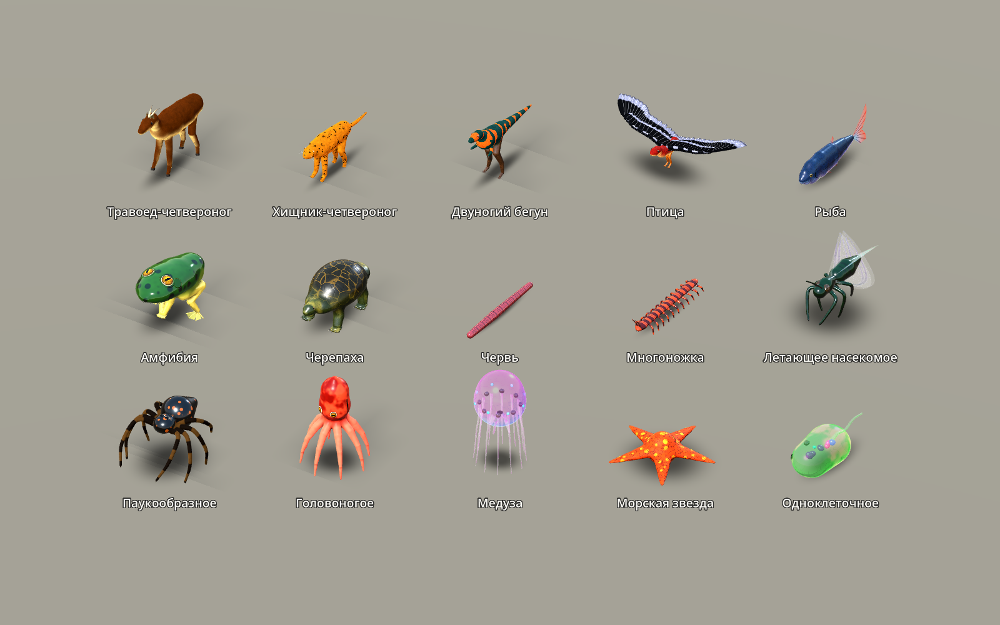
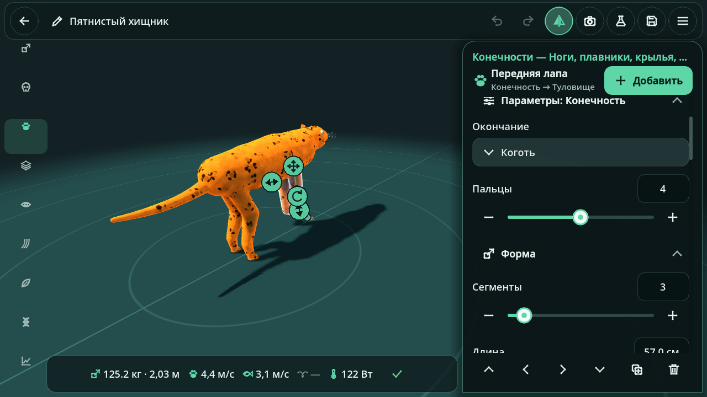
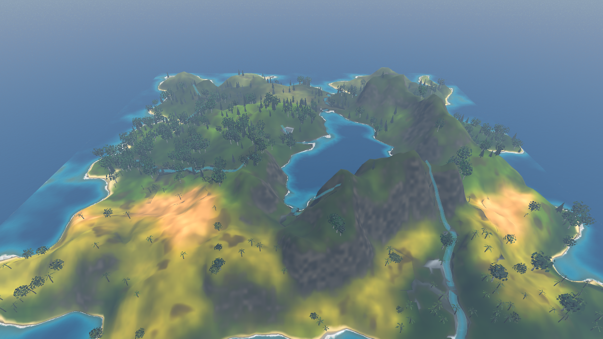
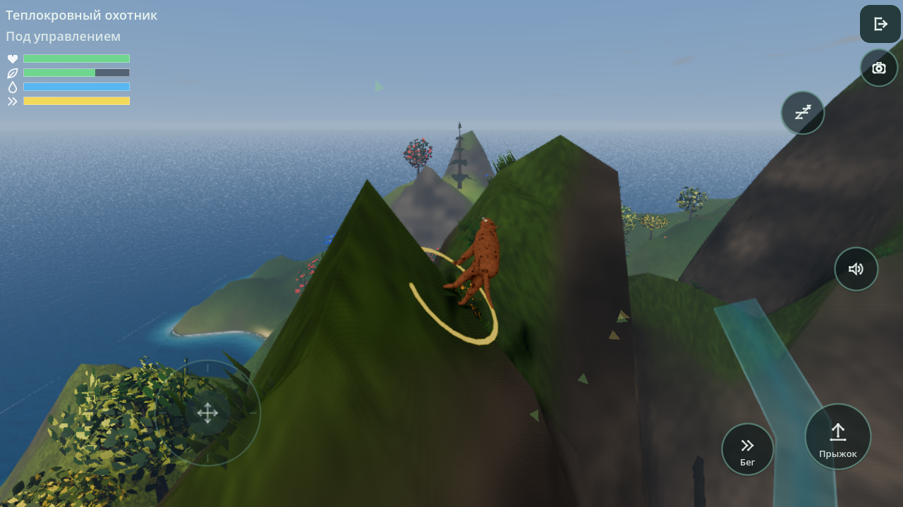

# Realm of Life

3D-песочница жизни, анатомии, экосистем и эволюции для мобильных устройств (Android/iOS)
с поддержкой ПК. Игрок проектирует организмы в анатомическом редакторе, заселяет ими
процедурный мир и наблюдает, как виды живут, охотятся, размножаются, мигрируют и
эволюционируют сотни поколений — с ускорением времени и без участия игрока.

Главный принцип — **причинно-следственная связь**: геном → анатомия → физические
возможности (опора, бег, плавание, полёт, органы чувств) → физиология (обмен веществ,
дыхание, терморегуляция, питание) → поведение и выживание → отбор → частоты аллелей.



| Редактор | Мир | Управление существом |
|---|---|---|
|  |  |  |

## Запуск

1. Установите [Godot 4.4+](https://godotengine.org/download) (проверено на 4.7.2, стандартная сборка без .NET).
2. Откройте папку проекта в Godot (Import → `project.godot`) и запустите (F5).
3. Экспорт на телефон: *Project → Export* → пресеты **Android** / **iOS** уже настроены
   (нужны шаблоны экспорта и собственные ключи подписи). Рендерер `mobile` автоматически
   откатывается на OpenGL ES 3 на устройствах без Vulkan.

## Что внутри

- **Редактор существ** — 9 режимов (форма, анатомия, конечности, покровы, чувства, органы,
  биология, генетика, диагностика), 15 стартовых организмов от клетки до осьминога,
  зеркальная/радиальная/сегментная симметрия, прямое сенсорное редактирование, анатомическая
  диагностика с объяснениями, библиотека видов.
- **Процедурная анатомия** — единая органичная поверхность тела (SDF + Surface Nets),
  скиннинг, 3 уровня детализации, 10 типов покровов и 10 узоров.
- **Живой мир** — процедурный рельеф с реками и озёрами, 14 биомов, процедурная флора и фауна,
  смена суток и сезонов, погода, влияющая на экосистему.
- **Биология и ИИ** — обмен веществ, дыхание, терморегуляция, питание, жизненный цикл,
  размножение; восприятие только через органы чувств, память, потребности, стаи, охота,
  территории, забота о потомстве; процедурная анимация с IK.
- **Эволюция** — менделевская генетика со сцеплением, мутации, естественный отбор,
  видообразование, филогенетическое дерево, журнал эволюции.
- **Песочница и эксперименты** — вмешательства в климат и популяции, контролируемые
  эксперименты «контроль vs вариант», контрольные точки и откат.
- **Многоуровневая симуляция** — особи рядом с камерой, популяционные модели вдали.

Подробный статус (реализовано / упрощено / нет): [`docs/STATUS.md`](docs/STATUS.md).

## Управление

| Действие | Сенсорный экран | ПК |
|---|---|---|
| Вращать камеру | перетаскивание одним пальцем | ПКМ + мышь |
| Сдвиг / масштаб | два пальца / щипок | СКМ / колесо |
| Выбрать существо | касание | клик |
| Управлять существом | кнопки «1-е лицо» / «3-е лицо» в карточке | те же |
| Движение существа | виртуальный стик слева | WASD, Shift — бег, Space — прыжок |
| Время | панель сверху: пауза, медленнее/быстрее, шаг | те же |

## Разработка

```bash
tools/reimport.sh   # пересборка кэша классов (после добавления class_name)
tools/test.sh       # headless-тесты (~39 000 проверок)
tools/shot.sh tools/preview_creatures.gd -- all   # скриншоты (нужен Xvfb)
```

- [`docs/ARCHITECTURE.md`](docs/ARCHITECTURE.md) — архитектура, подсистемы и их контракты.
- [`docs/STATUS.md`](docs/STATUS.md) — статус реализации и приоритеты.
- [`CLAUDE.md`](CLAUDE.md) — соглашения для разработки.
